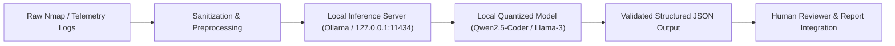
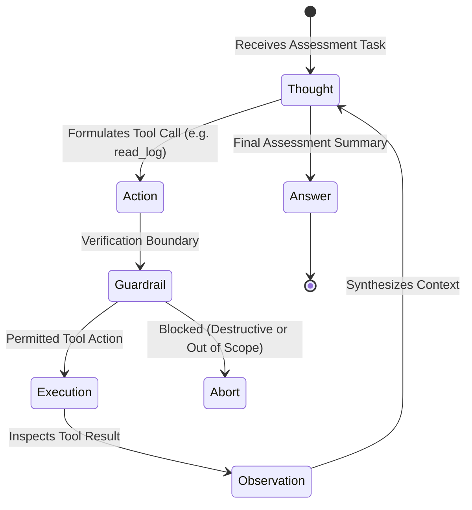

The integration of Artificial Intelligence and Large Language Models (LLMs) into cybersecurity operations accelerates log analysis, scan triage, and remediation reporting. However, deploying AI in security requires strict adherence to **data confidentiality**, **offline execution**, and **human-in-the-loop control**.

:::danger[Cloud Data Leakage Risk]
Submitting network topologies, unpatched CVE findings, internal hostnames, or authentication logs to public commercial AI APIs leaks sensitive security posture to third-party cloud infrastructure. All security AI pipelines should run on local, dedicated compute instances.
:::

---

## Local Inference Architecture with Ollama



### Deploying Local Inference Engine

```bash
# 1. Install Ollama local runtime
curl -fsSL https://ollama.com/install.sh | sh

# 2. Pull a high-capability cybersecurity & code reasoning model
ollama pull qwen2.5-coder:7b

# 3. Confirm model availability and resource allocation
ollama list
```

---

## Automated Vulnerability Triage with Python

Utilizing Python to connect directly to the local Ollama REST API (`/api/generate`) with guaranteed JSON output formatting:

```python
#!/usr/bin/env python3
import json
import requests

OLLAMA_ENDPOINT = "http://127.0.0.1:11434/api/generate"
MODEL_NAME = "qwen2.5-coder:7b"

def triage_vulnerability(service_banner: str) -> dict:
    prompt = (
        f"You are a defensive cybersecurity analyst. Given this service banner:\n"
        f"'{service_banner}'\n\n"
        f"Return a strict JSON object with these keys:\n"
        f"- 'cve': Primary associated CVE identifier or 'None'\n"
        f"- 'cvss_base': Estimated CVSS v3.1 score\n"
        f"- 'severity': 'Low', 'Medium', 'High', or 'Critical'\n"
        f"- 'remediation': Clear, actionable remediation advice for sysadmins."
    )
    
    payload = {
        "model": MODEL_NAME,
        "prompt": prompt,
        "format": "json",
        "stream": False
    }
    
    response = requests.post(OLLAMA_ENDPOINT, json=payload, timeout=30)
    response.raise_for_status()
    raw_text = response.json().get("response", "{}")
    return json.loads(raw_text)

if __name__ == "__main__":
    banner = "Apache httpd 2.4.49 (Unix)"
    print(f"[*] Triaging banner: {banner}")
    result = triage_vulnerability(banner)
    print(json.dumps(result, indent=2))
```

---

## Agentic Reasoning (ReAct Pattern) & Security Boundaries

Agentic workflows utilize the **ReAct (Reason + Act)** paradigm:



### Crucial Safety Constraints for Agentic Security:
1. **Read-Only Capability Baseline:** Default all autonomous agents to read-only tools (file readers, offline log parsers). Never grant write or network command tools without explicit authorization gates.
2. **Deterministic Isolation:** Execute any scripted tools inside disposable, non-root Docker containers with zero egress networking to avoid SSRF or unauthorized lateral pivoting.
3. **Never Blindly Trust Exploit Scripts:** LLMs are susceptible to hallucinations, obsolete flags, and non-existent parameters. Every command recommendation must be independently reviewed and verified by a human practitioner.

---

## OWASP Top 10 for LLMs Mitigations

| Threat Vector | Description | Defensive Control |
| :--- | :--- | :--- |
| **LLM01: Prompt Injection** | Attackers manipulate LLM inputs via untrusted data (e.g., embedding hidden instructions in HTTP headers or web pages). | Treat all third-party telemetry as untrusted data; isolate system instructions using structured schemas. |
| **LLM02: Sensitive Info Disclosure** | Training or prompt data exposes proprietary keys or credentials. | Run local models; execute automated regex credential stripping before feeding logs into prompts. |
| **LLM06: Excessive Agency** | Granting an LLM autonomous permissions to delete files, push code, or modify firewalls. | Enforce least privilege, require human-in-the-loop confirmations, and sandbox tools. |
