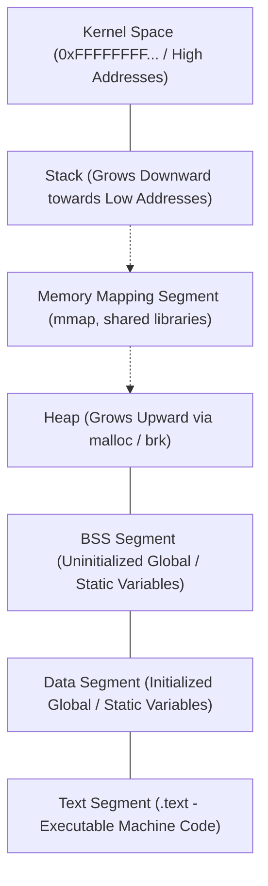

Binary exploitation examines how low-level programming errors in compiled languages (such as C and C++) can allow an attacker to corrupt memory layouts, hijack execution flow, and achieve arbitrary code execution. Modern operating systems and compilers implement layers of defense-in-depth mitigations to neutralize memory corruption vulnerabilities.

:::caution[Educational Purpose]
All binary analysis and exploitation techniques presented here are strictly for educational research in controlled laboratory environments and compiler security analysis.
:::

---

## Linux Process Memory Architecture

When an Executable and Linkable Format (ELF) binary is executed on Linux, the kernel maps virtual memory into distinct segments:



- **Stack:** Stores local variables, function arguments, and saved return addresses. Grows downward (from high memory to low memory).
- **Heap:** Stores dynamically allocated memory requested at runtime (`malloc`, `calloc`). Grows upward.
- **BSS Segment:** Uninitialized global and static variables (zero-initialized).
- **Data Segment:** Explicitly initialized global and static variables.
- **Text Segment:** Read-only segment containing the compiled CPU instructions.

---

## Stack Frame Anatomy & Buffer Overflows

A stack frame is pushed onto the stack whenever a function is called:

```text
High Addresses
+-----------------------------+
| Function Arguments          |
+-----------------------------+
| Saved Return Address (RIP)  |  <-- Overwritten to hijack control flow
+-----------------------------+
| Saved Frame Pointer (RBP)   |
+-----------------------------+
| Stack Canary (if enabled)   |  <-- Prevents buffer overflows if checked
+-----------------------------+
| Local Buffer [64 bytes]     |  <-- Vulnerable array (e.g. gets / strcpy)
+-----------------------------+
Low Addresses
```

### The Classical Stack Overflow Mechanic

If a program uses unsafe functions like `strcpy()`, `gets()`, or `scanf("%s")` without boundary checks, input exceeding the allocated buffer size overwrites adjacent stack variables, the saved frame pointer (`RBP`), and the saved instruction pointer (`RIP` / `EIP`).

When the function finishes execution and calls the `ret` (return) instruction, the CPU pops the corrupted address into `RIP`, redirecting execution flow to an attacker-controlled address.

---

## Modern Memory Defenses & Mitigations

Modern toolchains implement compiler- and kernel-level mitigations to prevent exploitation:

### 1. ASLR (Address Space Layout Randomization)
Randomizes the memory offsets of the stack, heap, and shared libraries upon every execution.
- **Inspection (Linux Kernel):**
  ```bash
  cat /proc/sys/kernel/randomize_va_space
  # 0 = Disabled, 1 = Partial (Stack + mmap), 2 = Full (Stack + Heap + mmap)
  ```

### 2. NX / DEP (No-Execute / Data Execution Prevention)
Marks writable memory regions (such as the stack and heap) as non-executable. Any attempt to execute instructions directly located on the stack raises a Segmentation Fault (`SIGSEGV`).
- **Bypass Concept in Research:** Return-Oriented Programming (ROP), which chains existing executable code snippets ending in `ret` instructions from the `.text` segment or libc.

### 3. Stack Canaries (Stack-Smashing Protection)
A pseudo-random 64-bit integer placed on the stack immediately before the saved return address. Before returning, the function compares the canary value against an internal master reference (`fs:0x28`). If modified, the program terminates immediately with `*** stack smashing detected ***`.

### 4. PIE (Position Independent Executable)
Compiles the binary as a shared object, allowing ASLR to randomize the base address of the `.text` segment in addition to libraries and stack.

### 5. RELRO (Relocation Read-Only)
Hardens the Global Offset Table (GOT), which maps dynamically linked library symbols.
- **Partial RELRO:** The non-PLT GOT is read-only; the PLT GOT remains writable.
- **Full RELRO:** All GOT references are resolved at load time and the entire table is marked strictly read-only (`r--`), preventing GOT overwrite attacks.

---

## Binary Security Auditing with `checksec`

Inspect the mitigation flags of any ELF binary using `checksec` (part of `pwntools`):

```bash
checksec --file=/usr/bin/sudo
```

**Interpreting Results:**
```text
[*] '/usr/bin/sudo'
    Arch:     amd64-64-little
    RELRO:    Full RELRO
    Stack:    Canary found
    NX:       NX enabled
    PIE:      PIE enabled
    Fortify:  Enabled
```

If an educational lab binary shows `No Canary found`, `NX disabled`, and `No PIE`, the binary is compiled with legacy parameters designed for learning fundamental stack mechanics.
