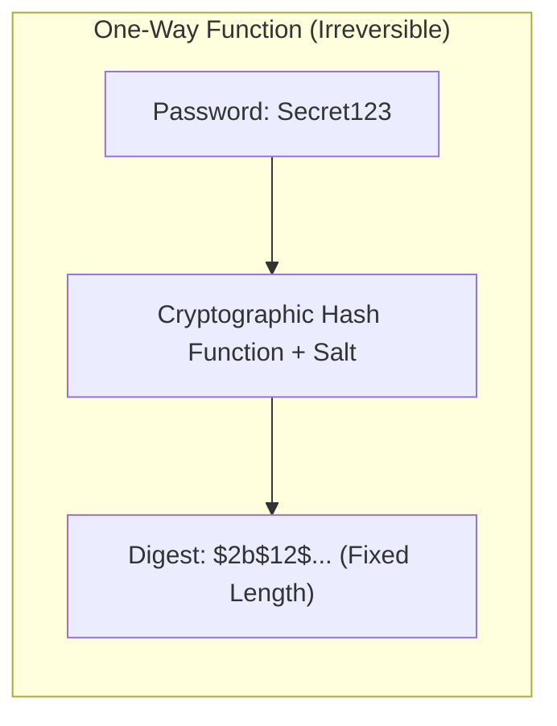
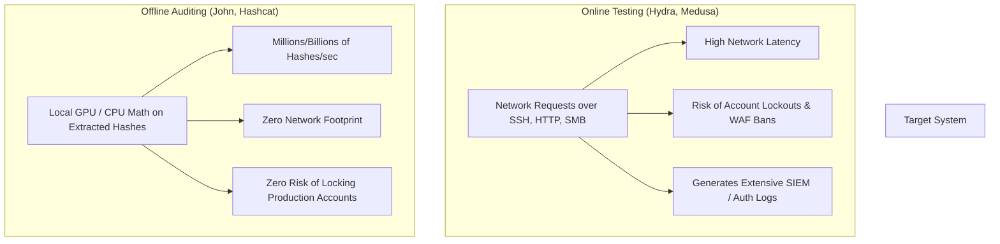

Authentication credentials form the primary perimeter of digital identity. In security auditing, understanding cryptographic hash structures, salt entropy, work factors, and verification workflows enables practitioners to assess password policy strength and identify vulnerable authentication storage implementations.

---

## Cryptographic Hashing Fundamentals



### One-Way Hashing vs Encryption

- **Encryption (Two-Way):** Transforms plaintext into ciphertext using an encryption algorithm and key. The original plaintext can be recovered with the decryption key.
- **Hashing (One-Way):** Transforms an arbitrary-length input string into a fixed-length hexadecimal or encoded digest. It is mathematically designed to be infeasible to invert without brute-forcing candidate inputs.

### Salting & Adaptive Work Factors

| Algorithm Class | Examples | Characteristics | Defensive Recommendation |
| :--- | :--- | :--- | :--- |
| **Legacy / Insecure** | MD5, SHA-1, NTLM | Fast computation, zero salt by default, vulnerable to precomputed Rainbow Tables and GPU brute force. | **Prohibited for passwords.** |
| **General Cryptographic** | SHA-256, SHA-512 | Fast computation designed for integrity checks, vulnerable to high-throughput GPU cracking when unsalted. | Prohibited for password storage without KDF wrapping. |
| **Adaptive Password KDFs** | **Argon2id**, **bcrypt**, **PBKDF2** | Configurable memory-cost and time-cost parameters (work factors). Resistant to GPU/ASIC parallelization. | **Recommended standard.** |

---

## Hash Algorithm Identification

Before conducting offline auditing in authorized lab assessments, identify the target hash digest syntax.

### Using `hashid` & `hash-identifier`

```bash
# Analyze a 32-character hexadecimal digest
hashid "5f4dcc3b5aa765d61d8327deb882cf99"
```

**Common Hash Signatures:**

| Digest Pattern / Example | Typical Hash Length | Identified Algorithm |
| :--- | :--- | :--- |
| `5f4dcc3b5aa765d61d8327deb882cf99` | 32 hex chars (128-bit) | MD5 / NTLM |
| `a591a6d40bf420404a011733cfb7b190d62c65bf` | 40 hex chars (160-bit) | SHA-1 |
| `$2a$12$e8NdwKwbGW12P...` | 60 chars prefix `$2a$` or `$2b$` | bcrypt |
| `$argon2id$v=19$m=65536,t=3,p=4$...` | Prefixed `$argon2id$` | Argon2id |

---

## Offline Hash Auditing with John the Ripper

John the Ripper (JTR) performs dictionary-based and rule-based offline verification against password digests.

### 1. Dictionary Auditing with RockYou

```bash
# Verify raw MD5 hashes against a wordlist
john --wordlist=/usr/share/wordlists/rockyou.txt --format=Raw-MD5 target_hashes.txt

# Inspect cracked credentials
john --show --format=Raw-MD5 target_hashes.txt
```

### 2. Auditing Linux Shadow Hashes

```bash
# Combine passwd and shadow files into an unshadow format for cracking
sudo unshadow /etc/passwd /etc/shadow > unshadowed.txt

# Run dictionary attack using SHA-512 crypt format
john --wordlist=/usr/share/wordlists/rockyou.txt --format=sha512crypt unshadowed.txt
```

---

## Online vs Offline Auditing Considerations



:::warning[Account Lockout Risk]
Never execute online brute-force attacks against production infrastructure. Doing so violates operational safety, triggers domain account lockouts, and disrupts business operations. Keep online testing strictly confined to dedicated staging systems with explicit authorization.
:::

---

## Defensive Recommendations for Password Storage

1. **Adopt Argon2id:** The Password Hashing Competition (PHC) winner. Set memory cost to at least 64 MiB (`m=65536`), iterations `t=3`, and parallelism `p=4`.
2. **Bcrypt Fallback:** Where Argon2id is unavailable, use `bcrypt` with a minimum cost factor of `12`.
3. **Always Use Unique Cryptographic Salts:** Generate salts using a cryptographically secure pseudo-random number generator (`CSPRNG`), with a minimum length of 16 bytes.
4. **Never Roll Custom Hashing Algorithms:** Always leverage established libraries (such as `libsodium`, `passlib`, or language-native crypto APIs).
