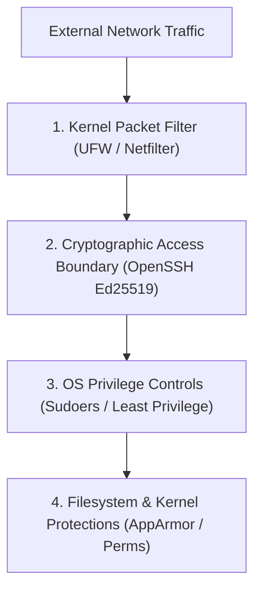

Hardening transforms a default, permissive Linux installation into a secure host by enforcing the principle of least privilege, reducing network attack surfaces, locking down remote management interfaces, and implementing active log auditing.

---

## Defense in Depth Architecture



---

## Host Firewall Configuration (`UFW`)

The **Uncomplicated Firewall (UFW)** provides an interface for managing Linux `iptables` and `nftables` netfilter rules.

### Safe Baseline Deployment

:::danger[Avoid Self-Lockout]
Always allow your active SSH port **before** enabling UFW. If you enable UFW with the default deny rule while managing a remote server without opening SSH, you will instantly sever your connection.
:::

```bash
# 1. Reset rules to a clean state (optional for fresh systems)
sudo ufw default deny incoming
sudo ufw default allow outgoing

# 2. Whitelist remote administration (rate-limited SSH)
sudo ufw limit 22/tcp comment 'Rate-limited SSH Access'

# 3. Whitelist web traffic if hosting public web servers
sudo ufw allow 80/tcp comment 'HTTP Service'
sudo ufw allow 443/tcp comment 'HTTPS Service'

# 4. Enable the firewall
sudo ufw enable

# 5. Review active rules with numbered index
sudo ufw status verbose
```

### Advanced UFW Rules

```bash
# Allow traffic exclusively from a trusted administrative bastion subnet
sudo ufw allow from 10.10.0.0/24 to any port 22 proto tcp comment 'Bastion SSH'

# Delete an obsolete rule by its index number
sudo ufw status numbered
sudo ufw delete 3
```

---

## OpenSSH Daemon Hardening

The OpenSSH daemon configuration file (`/etc/ssh/sshd_config`) is the primary gatekeeper for remote shell access.

### Recommended Configuration Directives

Edit `/etc/ssh/sshd_config` or deploy a drop-in configuration file to `/etc/ssh/sshd_config.d/99-hardened.conf`:

```ini
# Disallow root login directly via SSH
PermitRootLogin no

# Disable legacy, brute-forceable password authentication
PasswordAuthentication no
PubkeyAuthentication yes

# Disallow empty passwords
PermitEmptyPasswords no

# Disallow graphical forwarding and agent forwarding unless required
X11Forwarding no
AllowAgentForwarding no

# Limit failed authentication attempts before disconnecting
MaxAuthTries 3

# Idle timeout: disconnect after 10 minutes of inactivity
ClientAliveInterval 300
ClientAliveCountMax 2

# Accept modern cryptographic key exchange and ciphers only
KexAlgorithms curve25519-sha256,curve25519-sha256@libssh.org,diffie-hellman-group16-sha512
Ciphers chacha20-poly1305@openssh.com,aes256-gcm@openssh.com
MACs hmac-sha2-512-etm@openssh.com
```

### Configuration Validation & Reload

Always validate the configuration syntax before restarting or reloading the daemon:

```bash
# Test configuration syntax (-t triggers test mode)
sudo sshd -t

# If syntax is valid (no errors returned), reload the service safely
sudo systemctl reload ssh || sudo systemctl reload sshd
```

---

## Authentication & Audit Logging

Auditing authentication logs enables early detection of password spraying, brute-force attempts, and unauthorized privilege escalation.

### Inspecting System Logs

```bash
# View real-time authentication events via systemd journal
sudo journalctl -u ssh -f

# Filter for failed login attempts on Debian / Kali / Ubuntu
sudo grep "Failed password" /var/log/auth.log | tail -n 25

# On RHEL / Rocky / CentOS systems
sudo grep "Failed password" /var/log/secure | tail -n 25
```

---

## Filesystem Permission Audits

Misconfigured permissions—such as world-writable configuration files or unauthorized SUID binaries—frequently enable local privilege escalation.

### Locating Dangerously Permissive Files

```bash
# Find all world-writable regular files across the system
find / -type f -perm -0002 2>/dev/null

# Find world-writable files specifically within system configuration directories
find /etc /usr/local/etc -type f -perm -o+w 2>/dev/null

# Find world-writable directories lacking the Sticky Bit (drwxrwxrwt)
find / -type d -perm -0002 ! -perm -1000 2>/dev/null
```

### Auditing Sudo Privileges & Insecure Wildcards

Inspect the `/etc/sudoers` file and `/etc/sudoers.d/` directory for insecure rules:

```bash
# Check current user sudo rights
sudo -l

# Safe inspection of sudoers file (always use visudo to avoid syntax corruption)
sudo visudo -c
```

**Dangerous sudoers anti-patterns to eliminate:**
- `NOPASSWD: ALL` (allows root compromise without credential verification).
- `NOPASSWD: /usr/bin/find` or `/usr/bin/vim` (GTFOBins escape vectors).
- Insecure wildcards like `/bin/cat /home/*` allowing path traversal (`/home/../root/flag`).
