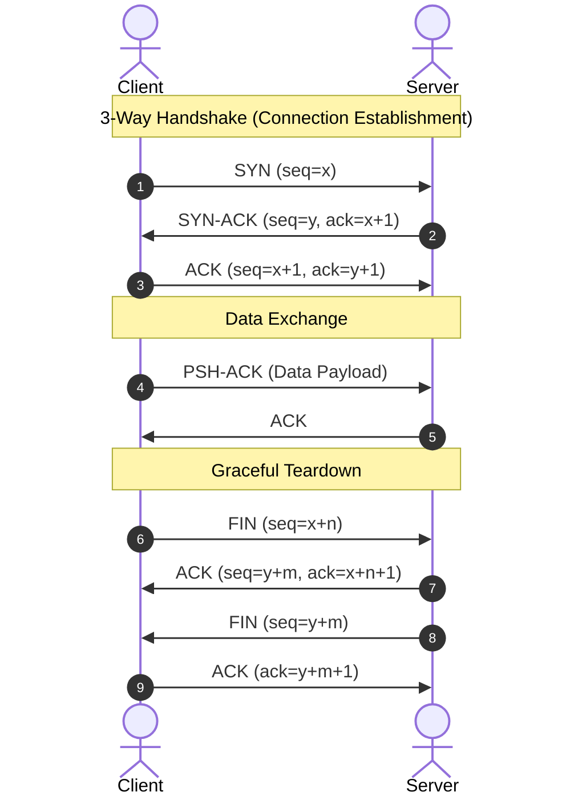

Network telemetry and packet-level inspection provide ground truth regarding host communication, application layer payloads, protocol anomalies, and unauthorized lateral movement.

---

## TCP Handshake & Connection Lifecycles

Understanding the flags within the TCP header is required for diagnosing connection issues and interpreting packet captures:



- **SYN (Synchronize):** Initiates a connection request.
- **ACK (Acknowledge):** Confirms receipt of previously transmitted packets.
- **PSH (Push):** Directs the receiving buffer to immediately forward data to the application layer.
- **RST (Reset):** Abruptly aborts a connection due to an unhandled state, closed port, or firewall drop.
- **FIN (Finish):** Gracefully informs the remote host that sender has finished transmitting data.

---

## Packet Capture with `tcpdump`

`tcpdump` operates in user space utilizing `libpcap` to capture packets directly from Linux kernel network interfaces.

### Common CLI Options

| Flag | Description |
| :--- | :--- |
| `-i <interface>` | Network interface (`eth0`, `any`, `tun0`). |
| `-n` | Do not resolve hostnames (prevents reverse DNS queries during capture). |
| `-nn` | Do not resolve hostnames or port names (displays numeric ports). |
| `-v`, `-vv`, `-vvv` | Increases verbosity (displays TTL, IP IDs, protocol options). |
| `-X` / `-XX` | Dumps packet headers and payloads in both Hex and ASCII format. |
| `-w <file.pcap>` | Writes raw packets to disk in libpcap format without parsing to screen. |
| `-r <file.pcap>` | Reads and parses an existing PCAP file from disk. |
| `-c <count>` | Stops capturing after receiving `<count>` packets. |

### Practical BPF Capture Examples

```bash
# 1. Capture HTTP traffic on eth0 without DNS lookup
sudo tcpdump -i eth0 -nn -c 50 port 80

# 2. Capture all traffic to or from a specific host
sudo tcpdump -i any -nn host 192.168.1.10

# 3. Capture SYN packets only (detect incoming connection attempts / syn sweeps)
sudo tcpdump -i eth0 "tcp[tcpflags] & (tcp-syn) != 0 and tcp[tcpflags] & (tcp-ack) == 0"

# 4. Stream capture to PCAP file with 10,000 packet limit
sudo tcpdump -i any -nn -w lab_incident_capture.pcap -c 10000
```

---

## Wireshark Display Filters

While BPF capture filters decide what is written to disk, Wireshark display filters evaluate loaded packets in memory.

### High-Value Display Filter Expressions

| Investigation Goal | Wireshark Display Filter |
| :--- | :--- |
| **Specific IP Conversation** | `ip.addr == 192.168.1.10 && ip.addr == 192.168.1.25` |
| **All TCP SYN Packets (Probes)** | `tcp.flags.syn == 1 && tcp.flags.ack == 0` |
| **RST Flagged Packets (Resets)** | `tcp.flags.reset == 1` |
| **HTTP POST Data Submissions** | `http.request.method == "POST"` |
| **HTTP Error Responses** | `http.response.code >= 400` |
| **DNS Lookups and Queries** | `dns.flags.response == 0` |
| **DNS Server Error Responses** | `dns.flags.rcode != 0` |
| **SMB File Operations** | `smb2.cmd == 5` (Create/Open) |

### Reconstructing Data Streams

1. Right-click any TCP packet in the Wireshark GUI list.
2. Select **Follow &rarr; TCP Stream** (or HTTP Stream).
3. Wireshark reassembles fragmented packets in chronological order, displaying client requests in red and server responses in blue.
4. Export raw stream binaries for malware or file exfiltration analysis via **File &rarr; Export Objects &rarr; HTTP**.

---

## Security & Privacy Considerations

:::caution[Privacy & Sensitive Data Handling]
Unencrypted network captures will record plain-text credentials (HTTP basic auth, FTP passwords, telnet sessions) and personally identifiable information (PII). Treat PCAP files containing production traffic as high-risk confidential assets:
- Store captures only on encrypted filesystems.
- Scrub sensitive credentials before sharing captures for incident retrospectives.
- Never capture on third-party networks without explicit contractual authorization.
:::
