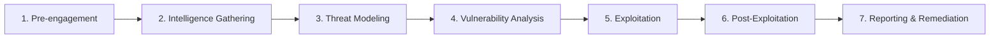

The ethical, legal, and procedural boundary separates authorized security research and penetration testing from unlawful computer intrusions. Professional security assessments adhere to recognized industry frameworks—such as the **Penetration Testing Execution Standard (PTES)**, **NIST SP 800-115**, and **OWASP Testing Guide**—ensuring predictable testing boundaries, minimal operational risk, and clear remediation guidance.

:::caution[Authorization Boundary]
Technical capability without explicit, written, and verifiable legal authorization from the system owner constitutes an unlawful breach. All testing techniques and commands documented in this Library must be performed strictly within authorized laboratory environments (e.g., TryHackMe, HackTheBox, or private isolated virtualization environments).
:::

---

## Rules of Engagement (ROE) & Scoping

The **Rules of Engagement (ROE)** is a binding legal and operational agreement executed prior to any testing activity. It formalizes:

- **Target In-Scope Assets:** Explicit CIDR blocks, fully qualified domain names (FQDNs), API endpoints, and cloud accounts.
- **Out-of-Scope Assets:** Third-party hosted services, production databases, shared infrastructure, and non-target subnets.
- **Permitted Testing Windows:** Designated hours (e.g., off-peak maintenance hours) to minimize production impact.
- **Prohibited Testing Techniques:** Explicit exclusions such as Denial of Service (DoS/DDoS), physical intrusions, credential stuffing of third parties, or destruction of production data.
- **Communication Protocol:** Designated primary and technical points of contact, secure PGP key exchanges for reporting, and emergency "halt testing" communication channels.

---

## PTES Assessment Phases

The Penetration Testing Execution Standard structures engagements into seven repeatable phases:



1. **Pre-engagement Interactions:** Scoping, contract signing, legal disclosures, and objectives definition.
2. **Intelligence Gathering (Reconnaissance):** Passive OSINT, DNS records enumeration, active service scanning, and network topology discovery.
3. **Threat Modeling:** Identifying asset value, threat actor profiles, attack surfaces, and business-critical entry paths.
4. **Vulnerability Analysis:** Discovering security misconfigurations, unpatched CVEs, software bugs, and weak access controls.
5. **Exploitation:** Controlled execution of proof-of-concept tests to confirm vulnerability validity without damaging systems.
6. **Post-Exploitation:** Determining the business impact of the flaw, evaluating sensitive data access, lateral movement paths, and persistence risks.
7. **Reporting:** Delivering executive risk summaries, detailed reproducible technical writeups, CVSS scores, and prioritized remediation actions.

---

## CVSS v3.1 Scoring Framework

The **Common Vulnerability Scoring System (CVSS v3.1)** provides an open, standardized framework for communicating the characteristics and severity of software vulnerabilities.

### Base Metric Group

| Metric | Values | Description |
| :--- | :--- | :--- |
| **Attack Vector (AV)** | Network (`N`), Adjacent (`A`), Local (`L`), Physical (`P`) | Context through which vulnerability exploitation is possible. |
| **Attack Complexity (AC)** | Low (`L`), High (`H`) | Conditions beyond attacker control that must exist to exploit the vulnerability. |
| **Privileges Required (PR)** | None (`N`), Low (`L`), High (`H`) | Level of privileges an attacker must possess prior to exploiting the flaw. |
| **User Interaction (UI)** | None (`N`), Required (`R`) | Requirement for a human user to participate (e.g., clicking a link). |
| **Scope (S)** | Unchanged (`U`), Changed (`C`) | Whether an exploited vulnerability affects resources beyond its authorization domain. |
| **Confidentiality (C)** | High (`H`), Low (`L`), None (`N`) | Impact on data confidentiality. |
| **Integrity (I)** | High (`H`), Low (`L`), None (`N`) | Impact on data accuracy and trustworthiness. |
| **Availability (A)** | High (`H`), Low (`L`), None (`N`) | Impact on service availability and uptime. |

### Severity Ratings

- **None:** 0.0
- **Low:** 0.1 – 3.9
- **Medium:** 4.0 – 6.9
- **High:** 7.0 – 8.9
- **Critical:** 9.0 – 10.0

### Vector String Examples

**Critical Unauthenticated Remote Code Execution:**
```text
CVSS:3.1/AV:N/AC:L/PR:N/UI:N/S:U/C:H/I:H/A:H  (Base Score: 9.8 - Critical)
```
- Remote network access (`AV:N`), no specialized conditions (`AC:L`), zero authentication needed (`PR:N`), zero user click (`UI:N`), total compromise of confidentiality, integrity, and availability.

**High Stored Cross-Site Scripting (XSS) with Scope Change:**
```text
CVSS:3.1/AV:N/AC:L/PR:L/UI:R/S:C/C:H/I:L/A:N  (Base Score: 7.6 - High)
```
- Low privileges required (`PR:L`), victim interaction needed (`UI:R`), scope changes to browser security context (`S:C`), session hijacking impact (`C:H`).

---

## Technical Finding Report Template

Use this standardized Markdown format when creating reproducible vulnerability findings:

```markdown
### [VULN-01] Unauthenticated SQL Injection in Authentication Endpoint

- **Severity:** High (CVSS 8.1 - `CVSS:3.1/AV:N/AC:L/PR:N/UI:N/S:U/C:H/I:H/A:N`)
- **Target Asset:** `https://target.internal.lab/api/v1/auth/login`
- **Vulnerability Type:** CWE-89 (Improper Neutralization of Special Elements used in an SQL Command)
- **Affected Parameter:** `username` (POST body JSON)

#### 1. Vulnerability Summary
The authentication API endpoint accepts a `username` string and interpolates the unvalidated value directly into an SQL database query string without parameterization or query binding.

#### 2. Technical Evidence & Steps to Reproduce
1. Send an HTTP POST request to `/api/v1/auth/login` with the following JSON payload:
```http
POST /api/v1/auth/login HTTP/1.1
Host: target.internal.lab
Content-Type: application/json

{
  "username": "admin' OR 1=1-- -",
  "password": "arbitrary_test_password"
}
```
2. The database query evaluates `TRUE` for the conditional statement and returns the administrative session token:
```http
HTTP/1.1 200 OK
Content-Type: application/json

{
  "status": "success",
  "token": "eyJhbGciOiJIUzI1NiIsIn...",
  "user": "administrator"
}
```

#### 3. Impact Assessment
An unauthenticated external attacker can bypass authentication logic, impersonate high-privilege administrators, and extract or modify sensitive records stored within the relational database.

#### 4. Remediation Guidance
- **Primary Fix:** Refactor database queries to use parameterized prepared statements (e.g., PostgreSQL `$1, $2` or PDO `:param`). Never interpolate variables directly into SQL statements.
- **Secondary Defense:** Enforce input validation schemas (allow-list characters) and adhere to the principle of least privilege for the database application user.
```

---

## Ethical Standards & Operational Safety

1. **Maintain Audit Logs:** Retain full timestamped logs of all scanner runs, payloads sent, and IP addresses used during the engagement.
2. **Handle Evidence Securely:** Store all captured database dumps, configuration files, and vulnerability screenshots on encrypted volumes (LUKS / BitLocker).
3. **Notify Immediately on Critical Finds:** If active breaches, default high-privilege credentials, or critical zero-day exposures are discovered, halt testing on that system and notify the technical contact immediately.
