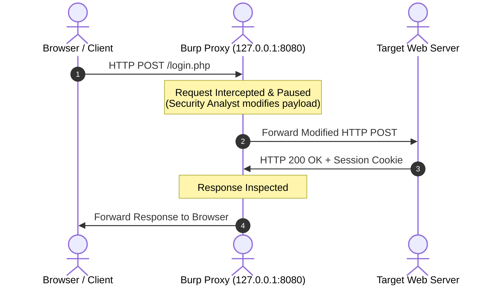

Web applications process heterogeneous, untrusted client inputs. Validating web application boundaries requires two foundational capabilities: **active directory and parameter fuzzing** (to discover unlinked endpoints and exposed assets) and **HTTP proxy interception** (to capture, inspect, and replay granular requests).

---

## Directory & Endpoint Fuzzing with `ffuf`

`ffuf` (Fast Web Fuzzer) is a high-performance Go-based HTTP fuzzing utility designed for discovering content, virtual hosts, and parameters.

### 1. Basic Directory Discovery

```bash
ffuf -w /usr/share/wordlists/dirb/common.txt \
     -u http://192.168.1.10/FUZZ \
     -mc 200,204,301,302,307,401,403
```

- `-w`: Wordlist location.
- `-u`: Target URL where `FUZZ` is the injection marker.
- `-mc`: Match comma-separated HTTP status codes.

### 2. Multi-Extension & File Discovery

Discover backend source code, configuration backups, and database dumps:

```bash
ffuf -w /usr/share/wordlists/dirb/big.txt \
     -u http://192.168.1.10/FUZZ \
     -e .php,.html,.json,.bak,.old,.txt \
     -t 40 \
     -rate 50
```

- `-e`: Appends each specified extension to every word in the wordlist.
- `-t 40`: Sets thread count to 40 concurrent workers.
- `-rate 50`: Throttles requests to 50 requests per second to avoid triggering DoS or rate-limiting bans.

### 3. Response Filtering (Eliminating False Positives)

When web applications return custom 200 OK error pages (soft 404s), standard status matchers fail. Use size, line, or word filters:

```bash
# Filter out responses that match exactly 1042 bytes in body length
ffuf -w /usr/share/wordlists/dirb/common.txt -u http://192.168.1.10/FUZZ -fs 1042

# Filter out responses containing 12 lines
ffuf -w /usr/share/wordlists/dirb/common.txt -u http://192.168.1.10/FUZZ -fl 12
```

---

## Burp Suite Proxy Interception Workflow

Burp Suite functions as a local man-in-the-middle (MitM) HTTP/S proxy positioned between your browser and the web application.



### Setup & CA Certificate Installation

1. By default, Burp Suite listens on `127.0.0.1:8080`.
2. Configure your browser proxy (or use FoxyProxy) to point to `127.0.0.1:8080`.
3. Navigate to `http://burp` in your browser and click **CA Certificate** to download `cacert.der`.
4. Import `cacert.der` into your browser's Trust Store under **Authorities** and enable "Trust this CA to identify websites" to inspect encrypted HTTPS traffic without SSL warnings.

### Burp Repeater for Manual Verification

1. When an interesting request passes through the Proxy, right-click and select **Send to Repeater** (or press `Ctrl+R`).
2. Navigate to the **Repeater** tab.
3. Modify HTTP headers, cookies, query parameters, or JSON payloads manually.
4. Press **Send** to observe server responses instantaneously without page reloads.

---

## HTTP Header Auditing via `cURL`

`cURL` provides a fast command-line method to audit security headers and responses without rendering client scripts.

### Inspecting Response Headers Only

```bash
curl -s -D - -o /dev/null https://target.internal.lab
```

### Output Evaluation Checklist

| Header | Expected Hardened Value | Security Purpose |
| :--- | :--- | :--- |
| `Strict-Transport-Security` | `max-age=31536000; includeSubDomains` | Enforces HTTPS and prevents SSL-stripping. |
| `X-Content-Type-Options` | `nosniff` | Prevents MIME-confusion attacks. |
| `X-Frame-Options` | `DENY` or `SAMEORIGIN` | Defends against Clickjacking framing attacks. |
| `Content-Security-Policy` | `default-src 'self'; ...` | Restricts script sources and prevents XSS execution. |
| `Server` / `X-Powered-By` | Omitted or sanitized | Disables server version fingerprinting. |
